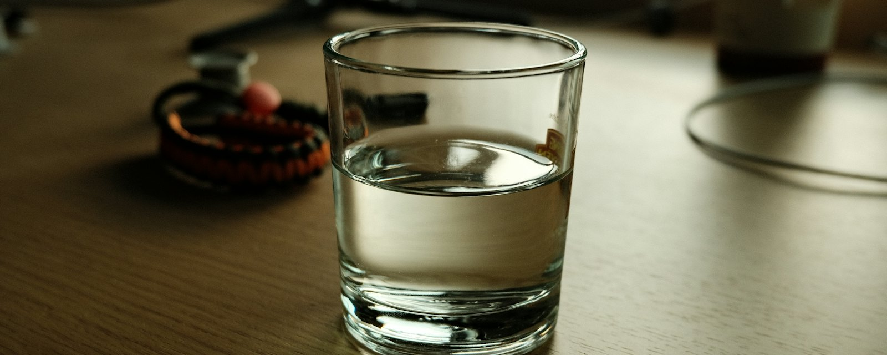
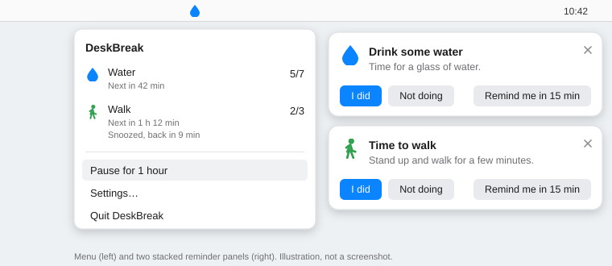

# DeskBreak



A small macOS menu bar app that reminds one person to **drink water every hour** and **walk every two hours** of *active* Mac time. Every reminder asks for an answer, and each one is logged as done, skipped or missed.

- Only time spent working counts. Timers freeze while the Mac sleeps, and pause while the screen is locked or there has been no input for 15 minutes. After you have been away for at least the idle threshold (15 minutes), the walk timer starts over, because that absence already counts as a break. Locking the screen for a moment does not reset it.
- Each reminder is a small silent panel in the top-right corner with **I did**, **Not doing** and **Remind me in 15 min** as buttons right underneath. It never takes keyboard focus. A snooze runs as its own timer and never moves the regular schedule.
- The menu shows time to the next reminders and today's done-out-of-fired counts, plus **Pause for 1 hour** and **Resume now**.
- Local only: no network access, no accounts, no analytics, no third-party dependencies.



*The menu and the reminder panels, drawn from the app's real labels. This is an illustration, not a screenshot.*

Requires macOS 13 (Ventura) or later and Xcode or the Xcode Command Line Tools.

## Install (Homebrew)

```sh
brew tap ananthanarayanan431/tap
brew install deskbreak
open "$(brew --prefix)/opt/deskbreak/DeskBreak.app"
```

Then, once:

1. Turn on **Launch at login** in DeskBreak's Settings. After `brew upgrade`, turn it off and on again so the login item points at the new version.

The tap repository must be named `homebrew-tap` on GitHub for `brew tap ananthanarayanan431/tap` to find it.

## Using the app

DeskBreak lives in the menu bar and has no Dock icon. The icon shows its state: a filled blue drop while counting, a grey moon while you are away or the screen is locked, and a grey pause symbol while paused. The blue colour itself tells you reminders are running.

Click the icon to see:

- A status badge next to the title: **Away**, **Locked**, or **Paused until** a time. Nothing is shown while counting.
- **Water** and **Walk**: time to the next reminder (marked "paused" while not counting), any pending snooze, and today's count as done out of fired (for example `5/7`). Counts reset at midnight.
- **Pause for 1 hour** / **Resume now**.
- **Settings…**: see below.
- **Quit DeskBreak**: stops all activity immediately. Timer state is saved, so the next launch picks up where it left off.

A warning appears in the menu if launch at login needs approval, with a button that opens the right System Settings page.

When a reminder fires, a panel appears in the top-right corner of the screen. The water panel says **Drink some water** and the walk panel says **Time to walk**; a snoozed reminder that comes back is labelled "Snoozed reminder". Water and walk reminders get separate panels, stacked when both are due. Click one of its buttons:

| Button | Recorded as |
| --- | --- |
| I did | done |
| Not doing | skipped |
| Remind me in 15 min (follows the **Snooze for** setting) | the answer to the follow-up, which returns after the snooze length of active time |
| No answer within the response window (15 seconds by default), or the X | missed |

## Settings

Changes apply immediately. **Restore defaults** resets every value.

| Setting | Default | Allowed range |
| --- | --- | --- |
| Water every | 1 h | 15 min – 8 h, in 15-minute steps |
| Walk every | 2 h | 15 min – 8 h, in 15-minute steps |
| Snooze for | 15 min | 1 – 60 min, in 5-minute steps |
| Answer within (response window) | 15 s | 15 s, 30 s, 1, 2, 5, 10, 15 or 30 min |
| Away after (idle threshold) | 15 min | 1 – 60 min, in 1-minute steps |
| Launch at login | off | |

If you shorten an interval, a countdown longer than the new interval is cut down to it. Longer intervals leave the current countdown as it is. Settings saved by an older version still load; any missing value takes its default, and out-of-range values are clamped.

## Build from source

```sh
scripts/build-app.sh          # creates build/DeskBreak.app, signed ad hoc
open build/DeskBreak.app
```

The app must run from the `.app` bundle; launch at login and its preferences need the bundle's `Info.plist` and identifier. `swift build` alone only checks that the code compiles.

Unit tests cover the scheduling and log rules in `DeskBreakCore`:

```sh
swift test
```

With only the Command Line Tools installed (no Xcode), SwiftPM may not find the Testing framework. Point it there explicitly:

```sh
F=/Library/Developer/CommandLineTools/Library/Developer/Frameworks
L=/Library/Developer/CommandLineTools/Library/Developer/usr/lib
swift test -Xswiftc -F -Xswiftc "$F" -Xlinker -F -Xlinker "$F" \
  -Xlinker -rpath -Xlinker "$F" -Xlinker -rpath -Xlinker "$L"
```

Shortcuts are in the `Makefile`: `make build`, `make app`, `make test` (adds the paths above automatically when Xcode is not installed), `make clean`.

### Install and update a local build

Installing a build into `/Applications` (needed for launch at login) and updating it after a code change are covered in [deploy.md](deploy.md).

## How it works

| Situation | Water timer | Walk timer |
| --- | --- | --- |
| Lid closed / Mac asleep | Freezes, resumes on wake | Freezes, resumes on wake |
| Screen locked, or no input for the idle threshold (15 min) | Pauses, resumes on return | Pauses; on return, resets to the full interval if you were away for at least the idle threshold |
| "Pause for 1 hour" | Pauses, with any pending snooze | Pauses, with any pending snooze |

- A regular timer restarts the moment its reminder fires, whatever the answer.
- If the next regular reminder of the same kind fires while a snooze is pending, the snooze is cancelled and that earlier reminder is recorded as missed.
- No answer within the response window (default 15 seconds), or closing with the X, records **missed** and removes the panel.
- The panel is not a system notification, so it needs no notification permission and still appears in Focus modes. It never becomes the active window, so typing in another app is never interrupted. It is excluded from screen recordings and screen sharing where macOS honours that.
- If you quit while a reminder is on screen, it comes back on the next launch if its response window is still open.
- Daily counts go by the day the reminder fired, so a reminder fired at 23:55 and answered at 00:05 counts for the earlier day.
- Timer state is saved continuously, so quitting or restarting resumes from the remaining time.
- "Pause for 1 hour" runs on wall-clock time. If the Mac sleeps through the pause, the pause has ended when it wakes.
- If a reminder is still on screen when the next one of the same kind fires, the older one is recorded as missed.
- Only one copy runs at a time. A second launch quits itself.

Active time comes from `SuspendingClock`, which does not advance during sleep. The app keeps a single timer that wakes only when something can change: a reminder becoming due, a response window closing, the pause ending, or the idle threshold possibly being reached. While you are away it checks for your return every 5 seconds. It does not poll while locked, because macOS reports the unlock.

### Reminder log

Every reminder is one entry in `~/Library/Application Support/DeskBreak/reminder-log.json`, human-readable JSON:

```json
{
  "records" : [
    {
      "firedAt" : "2026-10-10T09:00:00Z",
      "id" : "3F2B…",
      "kind" : "water",
      "resolvedAt" : "2026-10-10T09:02:14Z",
      "snoozeCount" : 0,
      "status" : "done"
    }
  ],
  "schemaVersion" : 1
}
```

`status` is `done`, `skipped` or `missed` once final, and `awaiting` or `snoozed` while a reminder is still open. Final entries older than 60 days are removed automatically.

If the file cannot be read, it is copied to `reminder-log.unreadable.json` in the same folder and a new log is started, so nothing is silently lost. A log written by a newer version of the app is never overwritten.

### Source layout

```
Sources/DeskBreakCore/   Pure logic (Foundation only): schedule rules, log, log file store
Sources/DeskBreak/       Menu bar app: controller, reminder panel, idle/lock monitor, SwiftUI views
Tests/                   Unit tests for DeskBreakCore
Resources/Info.plist     Bundle metadata template (LSUIElement: no Dock icon)
scripts/build-app.sh     Builds, assembles and ad hoc signs DeskBreak.app
packaging/homebrew/      Formula to copy into the homebrew-tap repository
docs/                    Static website (home, privacy policy, terms) and README images
.github/workflows/       CI: build, test and assemble the app bundle on macOS
```

### Website

`docs/` holds a plain HTML and CSS site with no build step and no JavaScript: `index.html`, `privacy.html`, `terms.html`, `style.css` and `favicon.svg`. It can be served by GitHub Pages from the `docs/` folder on `main`. The rules for its design and copy, and the checklist that must be finished before it goes live, are in [CLAUDE.md](CLAUDE.md).

## What the app touches

| Item | Location | How to remove |
| --- | --- | --- |
| The app | `$(brew --prefix)/Cellar/deskbreak/` | `brew uninstall deskbreak` |
| Reminder log (one JSON file) | `~/Library/Application Support/DeskBreak/` | `rm -rf ~/Library/Application\ Support/DeskBreak` |
| Settings and timer state | `~/Library/Preferences/io.github.ananthanarayanan431.deskbreak.plist` | `defaults delete io.github.ananthanarayanan431.deskbreak` |
| Login item | System Settings → General → Login Items | Turn off in DeskBreak, or remove from the list |

Safety rules enforced in the code:

- **One write path.** `LogFileStore.write(_:to:)` is the only code that writes files, and it refuses any path other than the log file (and a copy of an unreadable log) inside the app's own folder. There is no file picker, no user-supplied path and no delete operation.
- **No network, no subprocesses.** The source uses no networking API and never launches another process.
- **No elevated permissions.** No sudo, no Accessibility, Input Monitoring, Full Disk Access or Screen Recording. Idle detection reads only the seconds since the last input (`CGEventSource.secondsSinceLastEventType`).
- **Atomic writes.** The log is written to a temporary file and renamed into place.
- **No dependencies.** Only Apple frameworks.
- **Pinned source.** The formula builds a tagged release verified by SHA-256.

Diagnostics go to the unified log only: in Console.app, filter on subsystem `io.github.ananthanarayanan431.deskbreak`.

### Checks before daily use

- [ ] Read the source in full.
- [ ] `grep -rnE "URLSession|Process\(|FileManager" Sources`: the first two never appear; every `FileManager` use is in `LogFileStore.swift`.
- [ ] DeskBreak appears only under Login Items in System Settings, and in no Privacy & Security list.
- [ ] CPU and memory in Activity Monitor stay near zero between reminders.
- [ ] `brew uninstall deskbreak`, then delete the data folder and preferences, and confirm nothing else remains.
- [ ] Make a Time Machine backup before the first install.

## Uninstall

```sh
osascript -e 'quit app "DeskBreak"'       # or Quit DeskBreak from the menu
brew uninstall deskbreak
rm -rf ~/Library/Application\ Support/DeskBreak
defaults delete io.github.ananthanarayanan431.deskbreak
```

Then remove DeskBreak from **System Settings → General → Login Items** if it is still listed.

## Troubleshooting

| Problem | Fix |
| --- | --- |
| No reminders appear | Check that DeskBreak is running (its icon is in the menu bar) and not paused, and that the countdown in the menu is moving. It stops while you are away or the screen is locked. |
| Reminders vanish before I answer | Unanswered reminders are removed when **Answer within** runs out (15 seconds by default). Raise it in Settings for more time. |
| Launch at login stopped working after an upgrade | Turn **Launch at login** off and on again in Settings. |
| Running the binary prints "must run from DeskBreak.app" | Build the bundle with `scripts/build-app.sh` and open the `.app`. |
| I want to see what the app is doing | Open Console.app and filter on subsystem `io.github.ananthanarayanan431.deskbreak`. |

## Releasing

1. Bump `VERSION`, commit, then `git tag v$(cat VERSION) && git push --tags`.
2. `curl -L https://github.com/ananthanarayanan431/deskbreak/archive/refs/tags/v<version>.tar.gz | shasum -a 256`
3. Update `url`, `version` and `sha256` in `packaging/homebrew/deskbreak.rb` and copy it to `Formula/deskbreak.rb` in the `homebrew-tap` repository.

## Known limits (version 1)

- Reminders appear on the main screen only (the one with the menu bar).
- Watching a video or reading without input counts as idle after the threshold.
- Idle is detected when the threshold is reached, so the 15 idle minutes themselves count as active time. A reminder can fire during those minutes and then be recorded as missed.
- The source is about 1,800 lines (not counting tests), more than the few hundred first planned.

## License

MIT. See [LICENSE](LICENSE).

## Image credits

- Banner photo by [Quang Tran](https://unsplash.com/@quangtran304) on [Unsplash](https://unsplash.com/photos/a-glass-of-water-on-a-wooden-desk-p-Xc2noGZg4), used under the Unsplash License.
- The menu and panel illustration (`docs/images/readme-ui.svg`) was drawn for this README.
